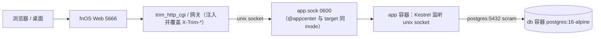
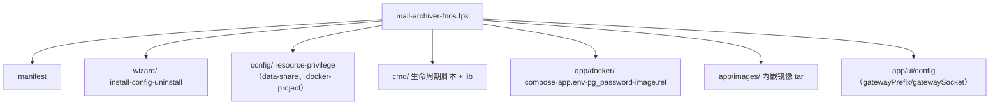
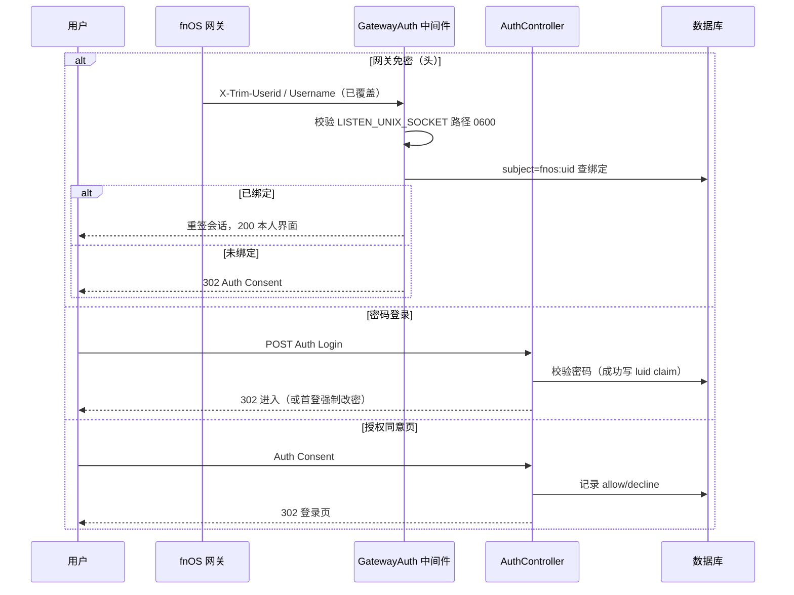
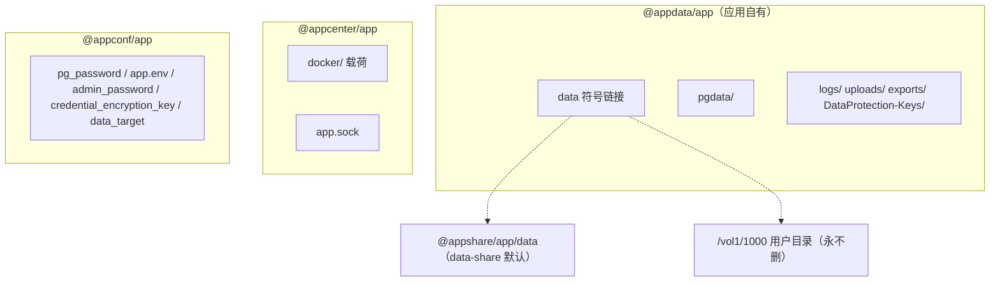
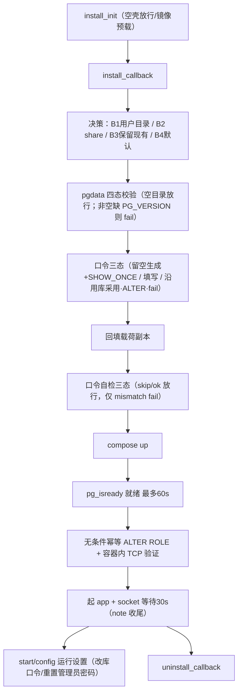
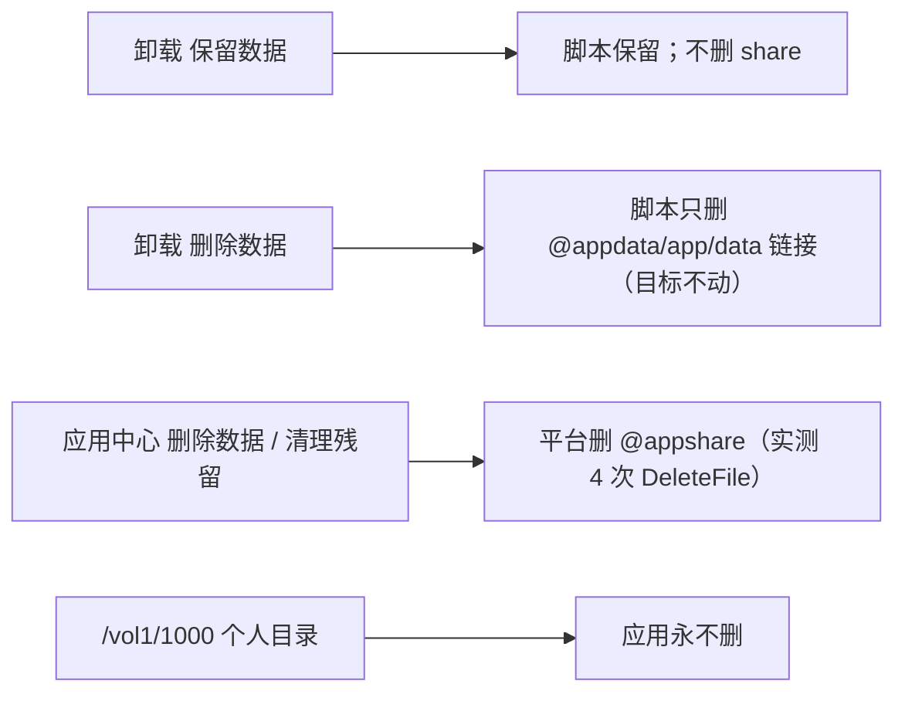

# Mail-Archiver（fnOS fpk）架构与拓扑

> 本文档描述打包发布版 `mail-archiver-fnos` 的应用逻辑与系统架构。所有"已实测"结论均来自真实设备取证；未最终确认处标 `待核实`。

## 0. 前置依赖

- fnOS 版本 `>=1.2.0401`（`manifest.os_min_version`），`x86_64`；
- Docker（应用与数据库均以容器运行）；
- 唯一联网点：`postgres:16-alpine`（固定大版本 16，勿手工升大版本；升级必须 `pg_dump`/`pg_restore`）；
- 应用自身**不发布任何 TCP 端口**（compose 无 `ports`，实测宿主无监听）。

## 1. 系统拓扑

- 网关对 `/app/<name>/` 请求强制注入并覆盖 `X-Trim-Userid`（uid）、`X-Trim-Username`（登录快照）、`X-Trim-Isadmin`，并剥离 fnOS token。
- 应用只经 unix socket 被访问，不监听 TCP；socket 权限 0600，即信任边界。

## 2. fpk 包结构

## 3. 身份认证链路

- 主键 = **uid**；`X-Trim-Username` 只是登录时快照（改名后过期）。
- `luid` claim 守恒：签发时写入，重签必须原样保留。
- 五支判定：无头放行（break-glass）｜`gw_sub==subject`｜已绑定→重签｜未绑定+已同意+`luid==uid`→放行｜其余→302 授权页。

## 4. 数据目录

| 目录 | 谁创建 | 谁读写 | 谁删除 |
|---|---|---|---|
| `@appdata/<app>` | 平台安装 | 应用 | 脚本仅删 `data` 链接（删除数据分支）；平台清理会删 |
| `@appcenter/<app>` | 平台安装 | 平台+应用 | 平台管理 |
| `@appconf/<app>` | 平台安装 | 脚本 | 平台清理 |
| `@appshare/<app>/data` | 应用 `mkdir` | 应用/db | 脚本**不删**；平台清理会删（`待核实` 是否每次） |
| `/vol1/1000/...` | 用户 | 用户/应用 | **永不删** |

## 5. 生命周期流程

## 6. 卸载与清理语义

- **脚本删什么**：仅 `@appdata/<app>/data`（且仅在"删除数据"分支；链接只删链接自身）。
- **平台删什么**：`DeleteFile` 事件（实测不总是发生；4 次集中在特定时段，与两次普通卸载无关）。
- **永远不删**：用户个人目录 `/vol1/1000/...`、`/vol2/1000/...`。
- 结论以实测为准，详见 `docs/UPGRADE-UNINSTALL.md`。

## 附录 A. 失败模式目录

| 现象 | 根因 | 判据 | 处置 |
|---|---|---|---|
| `28P01` | 库角色口令 ≠ 配置，或 ALTER 对齐失败 | app/db 日志持续 28P01 | 起库后无条件 ALTER + 容器内 TCP 验证；或重置 |
| socket 不存在/连接被拒 | 容器残留 `Created` 未起，或 `LISTEN_UNIX_SOCKET` 未传 | `docker ps -a`、`stat` | 清残留容器；核对 env |
| 打不开/404 | 实为 28P01 走错误页，非网关 404 | 直连 socket 得 302、网关得 `invalid token` | 按 28P01 处置 |
| 数据根空壳/不完整 | 上次迁移中断 | 目录在但缺 `PG_VERSION`/`base` | 换完整目录或新目录（四态校验会明确 fail） |
| data-share 被删 | 平台"删除数据/清理"操作 | journal 有 `DeleteFile @appshare/...` | 备份恢复；数据放个人目录最稳 |
| 口令占位符 `change_me` | 模板/兜底值被写入 | `@appconf/pg_password` 长度 9、头 4 位 chan | 写入闸口拒占位符 |
| `COMPOSE_FILE=/docker/...` 装不上 | `TRIM_APPDEST` 为空 | `exit status 1: open /docker/...` | `APPDEST` 兜底 |
| 网关免密被拒（要输密码） | 历史缺陷：读 socket 状态得 null | `Refusing gateway header authentication` | 中间件自读 `LISTEN_UNIX_SOCKET` + stat 0600 |

## 附录 B. 术语表

- **载荷**：`@appcenter/<app>/docker/`（compose、`app.env`、`pg_password`、`image.ref`），平台据此起容器。
- **data-share**：fnOS 应用共享数据目录，向导留空时的默认落点。
- **`.appstate`**：数据根旁运行期快照；仅当口令已被库验证通过才写 `pg_password`。
- **`PG_ALIGN_PENDING`**：沿用库且库尚未运行时置位（现改为无条件幂等 ALTER）。
- **`SHOW_ONCE`**：新库自动生成数据库口令时置位，完成页显示一次明文 + 指纹。
- **`--show-db-password`**：回显数据库口令明文（读 600 配置文件）；**`--show-db-fingerprint`**：只输出长度与前 8 位指纹。两者都不是登录密码。

## 附录 C. 待核实

1. 平台"删除数据/清理"是否**每次**都删 `@appshare`（现有 4 次证据，普通卸载两次未删）。
2. `@apphash`（若有）目录的创建/删除归属。
3. `@appshare` 在**升级**流程中是否被平台触碰。
4. 平台对 `/var/apps/<app>/target/app.sock` 的映射机制（依据日志推断）。

> Mermaid 中文渲染：节点文字一律双引号包裹，边标签避免裸括号/分号/井号等特殊符号。